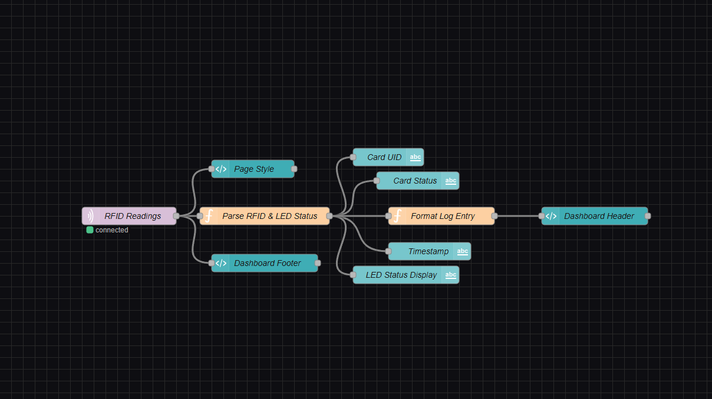
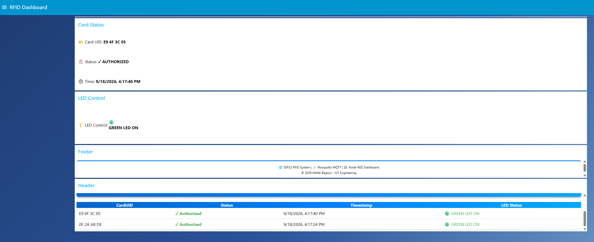
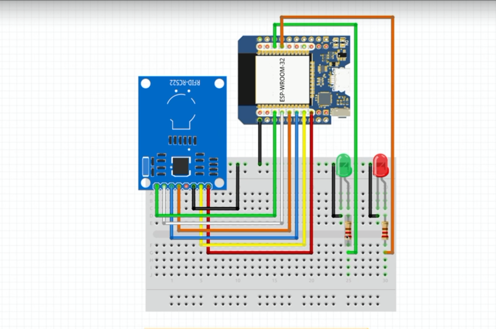
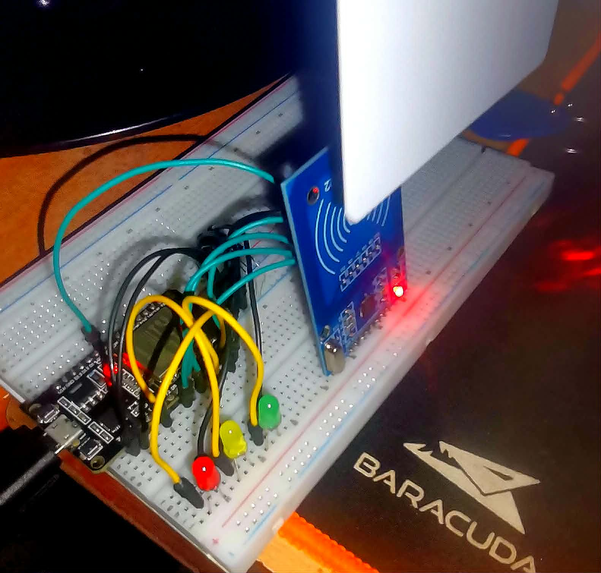

Set-Content -Path "README.md" -Encoding UTF8 -Value @'
# 🔐 RFID Access Control System with Node-RED & ESP32

An IoT-based RFID access control system built on an **ESP32** microcontroller. It reads RFID cards via an **MFRC522** module, publishes scan results over **MQTT**, and integrates with a **Node-RED** dashboard for real-time monitoring and remote control.

---

## 📸 Screenshots

### Node-RED Flow


### Node-RED Dashboard


### Wiring Diagram


### Real-Time Wiring


---

## ✨ Features

- 🔍 **RFID Card Detection** — Reads card UIDs using the MFRC522 reader over SPI
- ✅ **Access Authorization** — Grants or denies access based on the card UID
- 🟢🔴 **LED Feedback** — Green LED for authorized cards, Red LED for unauthorized cards
- 📡 **MQTT Communication** — Publishes card scan results as JSON to the broker
- 🖥️ **Node-RED Integration** — Full dashboard for real-time monitoring and control
- 🔄 **Remote Enable/Disable** — Toggle the check-in system via MQTT command from Node-RED
- 💡 **Remote LED Control** — Turn an indicator LED on/off from the Node-RED dashboard
- 🔌 **Auto-Reconnect** — Automatically reconnects to WiFi and MQTT on disconnection

---

## 🛠️ Hardware Requirements

| Component             | Quantity | Notes                          |
|-----------------------|----------|--------------------------------|
| ESP32 Dev Board       | 1        | Any standard ESP32 dev board   |
| MFRC522 RFID Module   | 1        | SPI interface                  |
| RFID Card / Tag       | 1+       | ISO 14443A compatible          |
| Green LED             | 1        | Authorized access indicator    |
| Red LED               | 1        | Unauthorized access indicator  |
| General LED           | 1        | Remote-controlled via MQTT     |
| Resistors (220Ω)      | 3        | Current limiting for LEDs      |
| Jumper Wires          | —        | —                              |

---

## 🔌 Wiring / Pin Configuration

### MFRC522 → ESP32

| MFRC522 Pin | ESP32 Pin | Description          |
|-------------|-----------|----------------------|
| SDA (SS)    | GPIO 26   | Slave Select         |
| RST         | GPIO 5    | Reset                |
| MOSI        | GPIO 23   | SPI MOSI (default)   |
| MISO        | GPIO 19   | SPI MISO (default)   |
| SCK         | GPIO 18   | SPI Clock (default)  |
| 3.3V        | 3.3V      | Power                |
| GND         | GND       | Ground               |

### LEDs → ESP32

| LED           | ESP32 Pin | Description                    |
|---------------|-----------|--------------------------------|
| Green LED     | GPIO 21   | Authorized card indicator      |
| Red LED       | GPIO 22   | Unauthorized card indicator    |
| General LED   | GPIO 4    | Remotely controlled via MQTT   |

---

## 📦 Software Dependencies

Managed automatically by **PlatformIO** (`platformio.ini`):

| Library             | Version  | Purpose                         |
|---------------------|----------|---------------------------------|
| `MFRC522`           | ^1.4.12  | RFID card reading (SPI)         |
| `PubSubClient`      | ^2.8     | MQTT client                     |
| `ArduinoJson`       | ^7.2.2   | JSON serialization/parsing      |
| `ESP32 AnalogWrite` | ^0.3     | Analog write support for ESP32  |
| `WiFiManager`       | ^2.0.17  | WiFi provisioning (available)   |

---

## ⚙️ Configuration

### 1. WiFi Credentials
Edit `src/Credential1.h`:
```cpp
const char *ssid     = "YOUR_WIFI_SSID";
const char *password = "YOUR_WIFI_PASSWORD";
```

### 2. MQTT Broker
Edit the MQTT settings in `src/main.cpp`:
```cpp
const char *mqtt_server   = "192.168.1.18";  // Your broker IP address
const char *mqtt_user     = "your_user";
const char *mqtt_password = "your_password";
```
> **Note:** The broker runs on port **1884**. Make sure your MQTT broker (e.g., Mosquitto) is configured on that port and that your firewall allows traffic through it.

### 3. Authorized Card UID
In `src/main.cpp`, update the authorized card UID to match your own card:
```cpp
if (content.substring(1) == "AC AC AC AC")  // Replace with your card UID
```
> Scan your card and read its UID from the Serial Monitor output, then paste it here.

---

## 📡 MQTT Topics

### Published by ESP32

| Topic           | Payload (JSON)                                                      | Description       |
|-----------------|---------------------------------------------------------------------|-------------------|
| `RFID/readings` | `{"cardUID":"XX XX XX XX","status":"Authorized","timestamp":12345}` | Card scan result  |

### Subscribed by ESP32

| Topic               | Payload              | Description                                        |
|---------------------|----------------------|----------------------------------------------------|
| `fromNodeRED`       | Any string           | General messages from Node-RED                     |
| `LedState`          | `ON` / `OFF`         | Control the general LED (GPIO 4)                   |
| `JSONfromNodeRED`   | JSON object          | Receive device config (`device`, `threshold`)      |
| `RFIDCommand`       | `ENABLE` / `DISABLE` | Enable or disable the RFID check-in system         |

---

## 🖥️ Node-RED Setup

1. Install **Node-RED** on your PC:
   ```bash
   npm install -g --unsafe-perm node-red
   node-red
   ```
2. Install and configure an **MQTT broker** (e.g., [Mosquitto](https://mosquitto.org/)) with your username and password. Make sure it listens on port **1884**.
3. In Node-RED, install the dashboard palette:
   - Go to **Menu → Manage palette → Install**
   - Search for `node-red-dashboard` and install it
4. Build a flow (or import an existing one) that:
   - **Subscribes** to `RFID/readings` → displays card UID and access status on the dashboard
   - **Publishes** to `RFIDCommand` → `ENABLE` / `DISABLE` button to control the reader
   - **Publishes** to `LedState` → `ON` / `OFF` button to control the general LED
5. Open the dashboard at `http://localhost:1880/ui`

---

## 🚀 Getting Started

### Prerequisites
- [PlatformIO IDE](https://platformio.org/) (VS Code extension recommended)
- MQTT Broker (e.g., [Mosquitto](https://mosquitto.org/)) running on your local network
- [Node-RED](https://nodered.org/) installed

### Steps

1. **Clone the repository:**
   ```bash
   git clone https://github.com/MelekBejaoui/RFID_Security.git
   cd RFID_Security
   ```

2. **Configure credentials:**
   - Edit `src/Credential1.h` → set your WiFi SSID and password
   - Edit `src/main.cpp` → set your MQTT broker IP, user, and password
   - Update the authorized card UID in `src/main.cpp`

3. **Build and upload with PlatformIO:**
   ```bash
   pio run --target upload
   ```

4. **Monitor Serial output:**
   ```bash
   pio device monitor --baud 115200
   ```

5. **Launch Node-RED** and open `http://localhost:1880` to configure your dashboard.

6. **Scan a card** — watch the Serial Monitor and the Node-RED dashboard update in real time!

---

## 📁 Project Structure

```
RFID with node red/
├── src/
│   ├── main.cpp          # Main firmware: setup, loop, RFID & MQTT logic
│   ├── wifimqtt.h        # Alternative WiFi/MQTT implementation
│   └── Credential1.h    # WiFi credentials (⚠️ keep private)
├── include/
│   └── README            # PlatformIO include directory info
├── images/
│   ├── Nodered.png          # Node-RED flow screenshot
│   ├── NoderedDashboard.png # Dashboard screenshot
│   ├── wiring.png           # Wiring diagram
│   └── realtimewiring.jpg   # Physical wiring photo
├── platformio.ini        # PlatformIO project configuration
└── README.md             # This file
```

---

## ⚠️ Security Notice

> **Do NOT commit `src/Credential1.h` with real WiFi credentials to a public repository.**
> Add it to `.gitignore` or replace its contents with placeholder values before pushing:
> ```
> src/Credential1.h
> ```

---

## 📄 License

This project is open-source and available under the [MIT License](LICENSE).

---

## 🙋 Author

**Melek Bejaoui** — IoT Developer
'@
